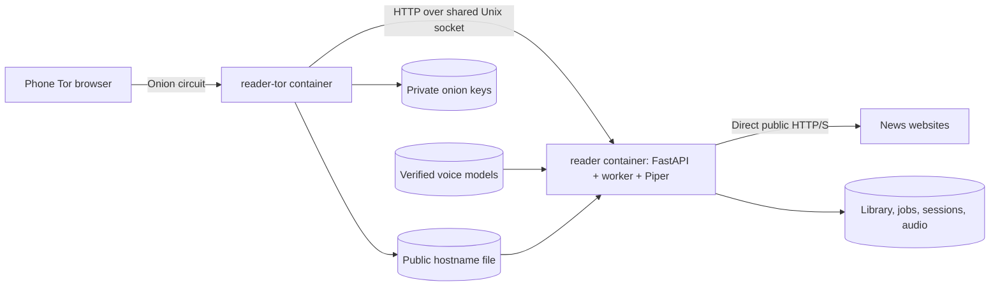

# Reader over Tor: architecture

Date: 2026-10-19 · Status: adopted and implemented; running host trial, phone acceptance open.

The owner wants this existing Reader on their own server, accessible from their phone's
Tor browser through a separate onion address. This document defines the adopted extension;
[the implementation plan](TOR_IMPLEMENTATION_PLAN.md) defines the work and release gates.
The existing desktop and trusted-LAN modes remain supported.

## 1. Scope and decisions

| Topic | Decision | Reason |
| --- | --- | --- |
| Deployment | Independent Compose project with `reader` and `reader-tor` services | Reader can be upgraded without changing the running chat stack |
| Application | Existing FastAPI app, one Uvicorn process, one durable worker thread, CPU Piper | Reuse the implemented pipeline and queue |
| Inbound access | Dedicated v3 onion service; HTTP over Tor; Unix socket to Reader | No host HTTP port, domain purchase, or router forwarding |
| Authentication | One owner password, separate revocable browser sessions | Re-login from the phone without returning to the server |
| Library | All onion owner sessions share one durable `viewer_id` | Same history and progress after browser data is cleared |
| Article fetching | Existing direct public HTTP(S) fetcher | Preserves DNS pinning and existing extraction behavior |
| Storage | Local Docker volumes for data, models, and Tor identity | Survive container replacement |
| Capacity | One reader instance; bounded queue, storage, and authentication work | Appropriate starting scope for personal use alongside chat |

The owner confirmed both choices on 2026-10-19: fetch articles through the Reader container's
normal outbound internet connection, and use an owner password with remembered browser sessions.
The phone-to-Reader connection uses Tor; article downloads do not. News websites see the host's
normal outbound public IP. These preferences are implemented; see [TOR_ACCEPTANCE.md](TOR_ACCEPTANCE.md)
for host evidence and open phone checks.

This extension has its own T0–T5 milestones. It does not rename the original M0–M5 milestones.
It pulls necessary storage protection forward from M5; portable bundles and the two-PC pilot
remain later work. Public registration, Django integration, shared login, Redis, a separate
worker service, and GPU inference are outside this release.

## 2. Deployment topology

Use two long-running containers. A one-shot provisioning command may reuse either image; it is
not another running service. A separate Tor service costs another small process but keeps chat's
configuration, keys, restarts, and release schedule independent. Reusing chat's Tor instance is
technically possible; it is not the selected design because it couples the two projects.

Tor targets `unix:/run/reader-http/http.sock`. The application binds only that Unix socket in
onion mode. Tor documents this forwarding option, and Uvicorn supports Unix-socket listeners.
[Tor setup](https://community.torproject.org/onion-services/setup/),
[Uvicorn settings](https://uvicorn.dev/settings/).

The socket directory is a dedicated shared volume, with two fixed non-root service UIDs and a
shared socket group. Use directory mode `02770` and socket mode `0660`; verify the actual umask
and group ownership in the built images. Only these services mount it. Unlink a stale socket
only after acquiring the instance lock and validating the expected path/type. Never use `0777`.

Neither service publishes host ports or uses host networking. Each can have its own private
Compose bridge with outbound connectivity; the socket supplies their application connection.
Do not attach either service to chat's networks. A network named `internal` is not automatically
isolated; Docker's `internal: true` disables external connectivity, which these services need
for Tor bootstrapping and direct article downloads. [Compose networks](https://docs.docker.com/reference/compose-file/networks/).

Trust the host administrator and Docker daemon. Socket isolation does not protect against a
compromised host or grant anonymity to outbound news requests.

## 3. Explicit serving modes

Replace the scattered `lan_mode` interpretation with one validated serving-mode policy:

| Mode | Listener | Browser identity | Accepted site origin |
| --- | --- | --- | --- |
| Desktop | Existing loopback TCP | Existing local bootstrap | Existing exact loopback authorities |
| LAN | Existing loopback + selected private TCP address | Local bootstrap; remote pairing | Existing exact desktop/LAN authorities |
| Onion | Unix socket only | Owner password login only | Exactly the configured onion origin |

Proposed CLI: `serve --onion --no-open --unix-socket PATH --onion-hostname-file PATH`.
These options do not exist yet. `--onion` and `--lan` are mutually exclusive and exposure
requires the CLI flag on every launch. Preserve existing `serve`, `serve --lan`, and TOML/env
compatibility with a tested mapping; reject contradictory combinations. Do not reinterpret
`lan_mode=true` as authorization for onion service or wildcard binding.

In onion mode, `_resolve_access` must never create an identity automatically, including when
`request.client` is absent, loopback, or appears to be a trusted proxy. Current code bootstraps
when `lan_mode` is false; changing only the listener would therefore be incorrect.

Use a deployment/access policy passed into the API composition root. Domain and application
services must not inspect Tor, socket addresses, Docker environment variables, or FastAPI objects.
Disable browser auto-opening and proxy-header trust. Tor forwards HTTP bytes; forwarded headers
are not proof of client identity, transport, or permission.

Load a validated canonical v3 hostname from the public handoff file, checking bounded length,
base32/version/checksum, no path/port/credentials, and no symlink escape. Freeze it at startup.
Accept that hostname, with optional explicit default port `:80`, and exactly its canonical
`http://…onion` Origin for mutations. Reject wildcard `.onion`, arbitrary Host, forwarded Host,
missing/null/foreign Origin, and non-JSON mutations. Health probes use the same correct Host.
Never make a request-supplied Host the configured authority. An unexpected identity change
must produce an operator-visible error and require an explicit rebind procedure.

## 4. Authentication and browser behavior

Create an owner credential through an interactive operator CLI. No signup endpoint or default
password. Store an Argon2id encoded password hash behind a narrow password-hasher port, with a
concrete `argon2-cffi` adapter. Pin the dependency through the normal lockfile workflow.
Its high-level API supplies salted Argon2id hashing; benchmark its parameters under the chosen
container memory limit. [argon2-cffi API](https://argon2-cffi.readthedocs.io/en/stable/api.html).

Proposed schema additions: a singleton owner record referencing a `viewers` row, credential
hash/revision, and session audience (`desktop_lan` or `onion_owner`). Existing sessions migrate
to `desktop_lan`; they do not become onion credentials. Select the next migration number at
integration time; do not rewrite v1/v2 migrations. Each successful onion login issues a fresh
opaque session for the owner, using the current hashed-token, expiry, and revocation machinery.
Accept only owner-scoped, onion-audience sessions in this mode. Login after lost cookies returns
to the same library, not a new viewer.

Proposed endpoint: `POST /api/auth/login`, JSON `{password, label}`. A failed login gives a generic
401. A bounded global throttle returns 429 with `Retry-After`; use persistent cooldown state
so restarting the app does not reset the budget. Proposed starting budget: five failures per
minute and a 60-second cooldown, with at most one concurrent password verification. Bound body
bytes before JSON parsing and password length before hashing. Run hashing off the event loop,
outside database transactions, and cap in-flight requests. Load testing must validate these
starting values; this throttle is not a claim of resistance to sustained denial of service.

The app cannot reliably distinguish phone IPs through Tor/Unix sockets. Do not base the main
throttle on source IP or trust `X-Forwarded-For`. Failed requests must not allocate viewers,
sessions, or unbounded per-client buckets. On verification completion, check credential revision
and session capacity transactionally before issuing a session. Reuse a valid current session
instead of allocating another merely because the user reloads the page.

Reuse session listing, per-device revocation, and logout. Keep the current session limit with an
explicit recovery path when stale phone sessions fill it; never silently evict active sessions.
Provide operator commands to initialize/reset the owner password and revoke all onion sessions.
For the first release these maintenance commands require Reader stopped and take its exclusive
data lock. Password reset revokes onion sessions atomically. Passwords are entered without echo,
never via command arguments, URLs, image layers, committed env files, or routine logs.

Use an onion-specific host-only cookie name, `HttpOnly`, `SameSite=Strict`, `Path=/`, and `Secure`.
Set its lifetime from the existing session configuration (currently 30 days by default), bounded
by server-side expiry and revocation. Remembered access lasts only while the browser keeps the
cookie; after browser-data clearing, password login restores the same server-side library.
Keep the current desktop/LAN cookie policy separate. Tor Browser has special treatment for secure
cookies on onion origins, but the actual phone browser must pass the cookie/login test before
release. Do not assume every app advertised as a Tor browser behaves identically, or silently
remove `Secure` if the pilot fails. Record a deliberate compatibility/TLS decision in that case.
[Tor browser behavior](https://blog.torproject.org/tor-brower-onion-services-challenges-opportunities/).

Onion HTTP protects browser-to-Tor-service traffic through the onion protocol; the final hop here
is a local Unix socket. This is different from the existing unencrypted LAN HTTP mode. TLS is
not required for this proposed topology; if Tor and Reader later move to different hosts, revisit
the final hop. [Tor HTTPS guidance](https://community.torproject.org/onion-services/advanced/https/).

In onion mode only the login shell, static assets, minimal auth/capability metadata, and
non-sensitive health status are public. All article, voice, history, job, manifest, progress, session, and audio routes
remain authenticated, including audio HEAD/Range. LAN pairing routes are disabled. Preserve
same-origin CSP, JSON/Origin checks, no-referrer, safe text rendering, and closed CORS. Expose
mode/capabilities explicitly in `/api/auth` and `/api/meta`; label the UI "Private server" and
explain that reading data lives on the server. Remove desktop-only pairing prompts in this mode.

## 5. Storage, images, and first startup

| Storage | Reader access | Tor access | Persistence |
| --- | --- | --- | --- |
| `reader-data` at `/data` | Read/write | None | DB/WAL, audio, staging, owner and sessions |
| `reader-models` at `/data/models` | Read-only during service operation | None | Approved model/config artifacts |
| `reader-tor-state` | None | Read/write | Tor state and private onion identity |
| `reader-onion-info` | Read-only | Write hostname only | Public hostname handoff |
| `reader-http` | Socket owner | Socket client | Runtime socket; safe stale-path handling |

Use local named volumes, not repository binds or synchronized/network filesystems. Volumes persist
independently of a container; deleting the Tor-state volume would lose the address. Document
destructive volume removal separately from normal stop/update commands.
[Docker volumes](https://docs.docker.com/engine/storage/volumes/).

Build a Linux CPU image using CPython 3.12, locked runtime dependencies, and the installed Reader
wheel including templates, JS/CSS, voice metadata, and language-detector resources. Use a supported
base release, record its digest and package versions, and keep compilers/dev dependencies out of
the final image. Verify native Piper/ONNX/phonemizer dependencies inside that image. Do not copy
the Windows runtime or the workspace venv. Start with the actual host architecture; do not label
an untested ARM image supported.

Models are provisioned explicitly into the model volume using the existing checksum-verifying
installer, then mounted read-only for serving. The speech engine must not download models on a
request or each startup. `ensure_runtime_dirs` and diagnostics must tolerate an existing read-only
model directory while checking write access for data/audio/staging. Preserve all three approved
voices and existing provenance notes; do not distribute their binaries in public images.

First-start sequence, to be implemented as documented operator commands:

1. Build images and provision volume ownership with narrowly scoped one-shot initialization.
2. Start Tor independently. It initializes persistent keys and atomically exports only `hostname`
   to the public handoff volume. No dependency on Reader readiness or an existing socket.
3. Install/verify the three voices with the Reader image, using a writable model mount only for
   this maintenance action. Initialize the owner interactively while Reader is stopped.
4. Start Reader. It validates owner configuration and hostname, acquires the data lock, applies
   migrations, checks models/storage, binds the socket, and starts one worker. Missing prerequisites
   fail clearly; no fallback to desktop bootstrap or an alternate interface.
5. Print the public onion URL from a dedicated command; open it on the phone and log in.

For a new deployment use a fresh owner library. If importing existing Reader data, stop the old
instance, make a consistent backup, verify schema/models, and explicitly select the viewer to
adopt. Never silently merge viewers or reassign all readings. Sessions must not be inherited as
onion access. Bundles are not implemented, so the runbook must not promise bundle-based migration.

## 6. Process ownership, failures, and storage bounds

Keep one Uvicorn process and one worker thread. No `--reload`, multiple API workers, or Compose
scaling against one data volume. Preserve FIFO jobs, generation-token fencing, cancellation,
leases, and atomic audio publication. Container restart is the recovery boundary for a stuck
native call; do not claim it provides a killable per-job subprocess.

Before Docker release, replace Linux PID-file liveness with a kernel-backed exclusive lock held
for the process lifetime, such as nonblocking `flock`. PIDs are namespace-local and reusable:
the current stale-PID check can mistake a previous container's PID for the new process. Test two
containers against one volume and forced termination/restart. Keep a stable lock-file inode;
never unlink an active advisory-lock file. Preserve the Windows implementation and its tests.
An old PID-lock build and a new advisory-lock build must not run against the same directory;
the upgrade procedure stops the old process before changing lock implementations.
[Python file locking](https://docs.python.org/3.12/library/fcntl.html).

Acquire the lock before migrations and worker startup, including maintenance commands. Preserve
SQLite on a local filesystem and short transactions. On SIGTERM stop claiming new work, allow
bounded shutdown, and leave interrupted work recoverable. Set Compose shutdown grace longer than
the app's measured cleanup window; test forced kill after that deadline. Use init/signal forwarding
and an exec-style entrypoint. Distinguish a busy synthesizer from a dead worker.

The current cache/history settings are not evidence of enforced limits. `delete_reading` currently
soft-deletes metadata and requests cancellation; it does not reclaim the audio files. Always-on
release therefore requires physical cleanup as well as admission checks.

Implement the M5 storage subset before routine use: whole-rendition LRU eviction, playback leases,
safe deletion cleanup, bounded staging/orphan recovery, and enforcement of audio/free-space limits.
Start with the existing configured 2 GiB audio budget and 1 GiB free-space floor. Count staging
and unpublished files; reserve capacity before generation/publication and recheck actual free
space. Fail explicitly when safe eviction cannot free enough; never delete a generating or leased
rendition. Atomic publication may temporarily require both staged and final metadata, so budget
for the real peak and test disk-full errors. Bound history and terminal-job retention as well.

Playback leases must account for Tor latency: refresh while playing, pin active audio requests,
and choose a measured grace interval so a transient reconnect does not evict the playing rendition.
On expiry/revocation, authorization still wins; cached/downloaded bytes cannot be recalled. Test
request/lease/eviction races and restart recovery rather than relying on filesystem timestamps.

Define modest CPU/memory/PID/log limits after measuring real synthesis alongside chat. These are
shared host resources; container separation alone does not prevent one app filling the disk or
starving the other. Log stable error codes and opaque job IDs, redacting raw URLs, article text,
credentials, cookies, and exception payloads that may contain them.

## 7. Fetching and phone playback

Direct fetching is separate from serving the UI through Tor. News publishers see the server's
normal public IP; their HTTPS connections use the existing certificate checks. Keep public-IP
validation, DNS pinning, redirect revalidation, byte/time limits, and blocked private destinations,
including Docker services and host addresses. Explicitly reject article `.onion` destinations in
this release. No SOCKS environment toggle may bypass that contract.

A future Tor-fetch adapter would need a deliberate remote-DNS/SSRF design and separate tests;
pointing the existing fetcher at SOCKS is not sufficient. This extension does not claim anonymous
news fetching or support for sites requiring authentication/JavaScript extraction.

Keep progressive WAV chunks, authenticated Range requests, bounded reconnect polling, playback
speed and revisioned progress. At the current 22,050 Hz, mono, 16-bit PCM format the audio payload
is about 353 kbit/s, or 159 MB per hour (decimal units, excluding headers). Measure actual phone
throughput and chunk-transition gaps over Tor before changing codecs. If sustained playback fails,
record a follow-up codec/buffering decision; do not quietly add transcoding dependencies or promise
background playback. Test actual phone/browser/version, normal security setting, user-initiated
play, seeking, session expiry, network interruption, and optional media APIs. JavaScript is required;
record any browser setting needed instead of disabling browser protections automatically.

## 8. Operations and release boundary

Use separate application liveness, application readiness, and Tor bootstrap checks. Readiness
checks database/migrations, owner setup, verified models, usable storage, socket, and worker
supervision. A busy worker must not fail a simplistic heartbeat check. Health endpoints reveal no
library or credentials and create no sessions. A healthy Tor process is not proof that the phone
can load the onion site; external access is a separate smoke test. Compose health status does not
itself restart unhealthy containers; bounded process exit or an explicit operator action handles
unrecoverable application failure. Avoid an automatic restart storm.

Prefer Tor `SocksPort 0` and no TCP ControlPort. If bootstrap status needs control access, use a
container-local Unix ControlSocket with cookie authentication. Do not copy chat's unauthenticated
ControlPort configuration. Run services non-root, drop unnecessary capabilities, use
`no-new-privileges`, and test read-only root filesystems with only required writable mounts/tmpfs.

Back up Reader while it is stopped, including its complete data tree; back up Tor state while Tor
is stopped. Protect owner hashes, sessions, article data, and onion private keys. Models can be
reinstalled by pinned checksums, but record the catalogue/image revision. Store backups outside
the live volumes and outside Git. Restore-test a disposable deployment. Never run two published
services with the same restored onion identity. Never copy a live SQLite main file without WAL.

Updates are deliberate: record image revision, stop Reader, back up, migrate/start the new image,
then run readiness and onion smoke checks. Rollback after a schema change restores a matching
backup plus application version; it is not just selecting an older image. No unattended pull of
`master`, recurring forced restarts, or destructive `down -v` in the normal runbook.

Release requires T1–T5 evidence in the implementation plan. Until those checks pass, this remains
an architecture proposal, and the running chat service remains outside the change scope.
